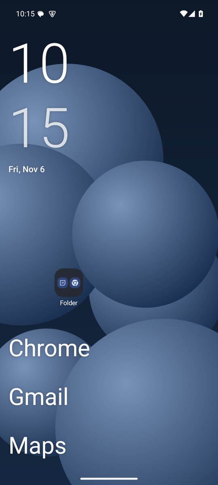
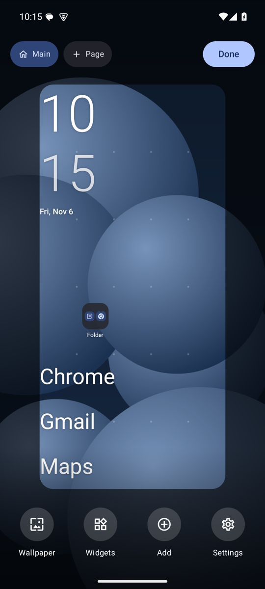
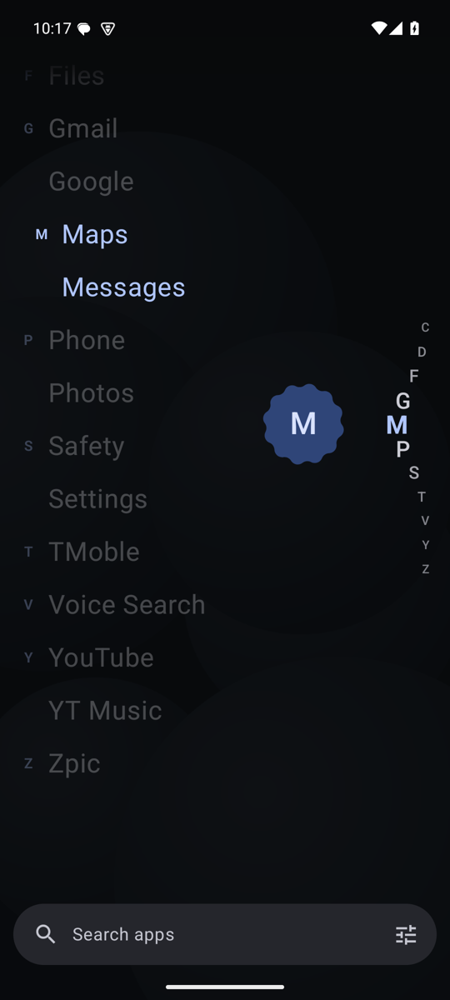
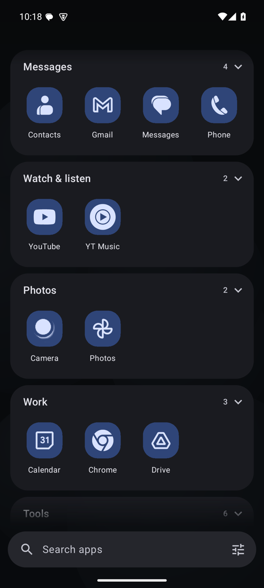
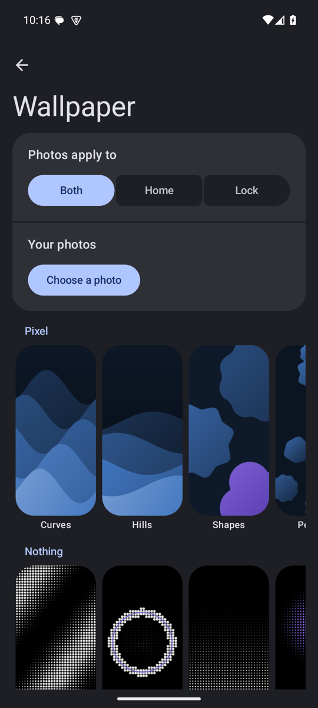

# Zpic Launcher: minimal Android launcher with Material You


**[Download the APK](https://github.com/SAKTHIVEL280/zpic-launcher/releases/latest)** · **[Website](https://sakthivel280.github.io/zpic-launcher/)**

<p>





</p>

A minimal Android launcher: stock feel, Material You colour, Material 3 Expressive motion, and deep customization kept out of sight. Kotlin + Jetpack Compose, minSdk 29, about 3 MB.

Install the APK from Releases, open **Zpic**, tap **Set as default**.

## Why Zpic

A free, open-source alternative to launchers like Nova, Niagara, Lawnchair and Olauncher, for people who want a minimal Android home screen that still feels like stock Android. No ads, no account, no internet permission.

## Using it

- **Swipe up** for apps. **Swipe down** for notifications. **Double-tap** to lock.
- **Hold** anything on home and drag it, or hold empty space to arrange. Pull a corner to resize. Drop an app on another to make a folder.
- **Long-press an app** to pin, rename, hide, add a pause, see its shortcuts or uninstall.
- **Four app pages:** names A to Z, icons, custom pages or smart groups (Customize → App pages).

## What's in it

| Area | Options |
|---|---|
| Colour | System colours (Material You, or tools such as ColorBlendr), directly from the wallpaper, or 6 fixed palettes; light/dark, pure black |
| Motion | Expressive, Standard, Reduced; speed and bounce sliders; 4 app-open animations; haptics with a strength control |
| Clock | Pixel stacked, Android inline, One UI slim, iOS bold, Nothing dot matrix, OxygenOS two-tone, HyperOS condensed, Material cards, analog, words, small, none. Size, weight, colour, hour format, leading zero, AM/PM, date format and position |
| Home | Fine grid of up to 16 columns and 20 rows, multiple pages, widgets, folders, a dock, a notification shelf, undo, layout presets, a layout lock, and a hidden status bar option |
| Search | Fuzzy app search, a calculator, and web fallback |
| App pages | Names A to Z, icons with labels, custom pages (drag apps to any cell), smart groups. A separate Recent card with how long ago each app was used |
| Icons | Full colour, Tonal, Surface, Glyph only, Monogram; 7 shapes; Nova/ADW icon packs |
| Wallpaper | 60 original designs, 10 in the spirit of each of Pixel, Nothing, One UI, iOS, OxygenOS and HyperOS. Tap one to set its colours, detail and light version. Or use a photo; apply to Home, Lock or both; keep the lock screen matched; dim |
| Focus | Pause before distracting apps, hidden apps, notification dots |
| Backup | Save and restore the whole setup as one JSON file |

Icons drawn as flat PNG or JPG images are converted too: the logo is lifted off its plate and recoloured to match. If an icon has no usable logo, it becomes a monogram rather than a blank block.

Smart groups use the app's name, what it can do (an app that handles `upi://pay` is a payment app) and its declared category. Their order never changes with use, so muscle memory holds. Long-press an app to move it. Any single icon can be changed from its long-press menu.

Wallpapers are written to home and lock separately, and can be handed to the phone's own wallpaper app.

Only the phone's own launcher may run the full shared app-open animation. Zpic uses the best transition Android offers other launchers, and moves the home screen with it.

## Permissions

Off until you enable them: **Accessibility** (only to lock the screen) and **notification access** (only for dots).
Usage access is optional, for showing apps opened outside Zpic in Recent. `QUERY_ALL_PACKAGES` reads icon packs. `EXPAND_STATUS_BAR` uses a hidden API, so swipe-down could fail on a heavily modified ROM.

## Research behind the design

Sources are reviews, forums and developers' own claims, not user surveys, so treat these as signals.

- People praise fast, ad-free, list-driven launchers, and worry about abandonment after Nova's troubles ([Android Authority](https://www.androidauthority.com/best-android-launchers-3580969/), [SlashGear](https://www.slashgear.com/2237061/best-android-launchers-must-try-2026/)).
- Niagara is criticised for thin customization ([Computerworld](https://www.computerworld.com/article/1700995/android-launcher-ergonomic-efficiency.html)), so Zpic has depth, one layer down.
- Ultra-minimal launchers can be too austere, and KISS lacks widgets ([AlternativeTo](https://alternativeto.net/software/niagara-launcher/)), so Zpic keeps one widget slot.
- Pauses are designed as speed bumps, not walls ([Defang](https://f-droid.org/en/packages/com.defang.launcher/), [Pause](https://www.raftlabs.com/portfolio/pause-screen-time-app), [a Niagara request](https://niagaralauncher.featurebase.app/p/intent-based-delay-for-distracting-apps)). Their effectiveness figures are unverified vendor claims.
- Open [Kvaesitso requests](https://github.com/MM2-0/Kvaesitso/issues) include long-press access to settings and a dead zone near the dock; Zpic's long-press menu covers the first. Weather on the clock is also requested and left out on purpose, to stay minimal.
- Themed icons follow [Android's adaptive icon guidance](https://developer.android.com/develop/ui/views/launch/icon_design_adaptive).

## Building

```
./gradlew :app:testDebugUnitTest :app:assembleRelease
```

Material 3 is pinned to `1.5.0-rc01` because `MotionScheme` is internal in stable 1.4.0. It's a release candidate, so move to 1.5.0 stable when it ships ([release notes](https://developer.android.com/jetpack/androidx/releases/compose-material3), [MotionScheme API](https://developer.android.com/reference/kotlin/androidx/compose/material3/MotionScheme)).

The release APK is signed with the debug key so it can be sideloaded. Before publishing: create your own upload key, and change `applicationId` if you want a different one, because it can't change afterwards. Store text, icon and privacy policy are in `store/`.

## Contributing

Issues and pull requests are welcome. Run `./gradlew :app:testDebugUnitTest` before opening one.

## License

Apache 2.0. See [LICENSE](LICENSE).
